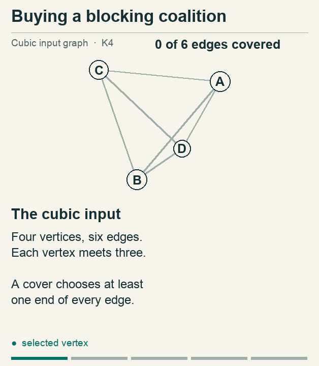

# Core verification with at most three mutual friends

  

Can one efficiently verify core stability or strict core stability when everyone has at most three mutual friends? The original question appears in [Simola, dissertation, §5.5](https://doi.org/10.34726/hss.2026.138201).

**Result.** Both partition verification problems are coNP-complete for symmetric friend-oriented hedonic games without neutrals and with at most three mutual friends. With at most two they are polynomial-time decidable.

[Read the paper (PDF)](paper/manuscript.pdf) · [LaTeX source](paper/manuscript.tex) · [Proof guide](proof/PROBLEM_AND_PROOF.md) · [Reproduce the checks](REPRODUCIBILITY.md)

## Explore the proof in 3D

Choose B and C. Five of the six edges have a chosen endpoint. Adding D pays for the last one. The labels stand for vertices of the *input* graph. In the friendship game each choice costs an entire gadget of 20 agents. [Download the offline explorer](https://github.com/DannyExperiments/subcubic-friend-oriented-core-verification/raw/refs/heads/main/visualization/coalition-explorer.zip), unzip it and open `index.html` to rotate the graph, select any of its vertices and compare budgets two and three.

## How the reduction works

Each agent wants more friends in their group. With the same number of friends, they prefer the smaller group. For **core stability**, a group can break away if every member strictly benefits. For **strict core stability**, all members must do at least as well and at least one must strictly benefit.

The input to the reduction is a cubic graph and a number $k$. A vertex cover is a choice of vertices meeting every edge. Each input vertex becomes two triangles connected by a bridge, with a tether and a port for each incident edge. The friendships force any sufficiently large acceptable coalition that selects part of this gadget to take it all. Each edge has a switch that needs support from at least one endpoint gadget. The size of the original partition block puts a cap on the number of gadgets the coalition can afford.

In the illustrated example, choosing three vertices yields a coalition of 100 agents. The original block has 101. Every incoming agent gains a friend, and the original agents keep at least as many friends in the smaller group. In the reverse direction, even a weakly blocking coalition must pay for a vertex cover within budget. These two implications give hardness for both questions.

## What you can check

The [complete proof](paper/manuscript.pdf) covers arbitrary cubic inputs and proves the equivalence in both directions. The [finite verifier](verification/src/replay.py) also compares 240 small-game tests with exhaustive enumeration and checks 38 coalition decisions against the vertex-cover answer. The [worked example](visualization/README.md) gives the agent counts in the animation.

Internally reviewed, not peer reviewed. [Mathematical audit](audits/public_safe_reports/MATHEMATICAL_AUDIT.md) · [Literature and priority](audits/public_safe_reports/LITERATURE_AUDIT.md) · [Citation](CITATION.cff)
